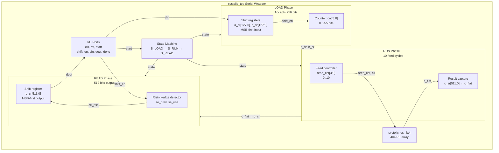

# Systolic Wrapper (systolic_top) Block Diagram

## State Machine Description

### LOAD State
- **Entry**: After reset or end of READ
- **Action**: Shift in 256 bits via `din` while `shift_en=1`
  - Bits 0–127: A[0:15] (8 bits each), MSB first
  - Bits 128–255: B[0:15] (8 bits each), MSB first
- **Exit**: After 256 bits received, wait for `start=1` → transition to RUN

### RUN State
- **Entry**: When `start=1` and all 256 bits loaded
- **Action**: Feed cycle loop
  - `feed_cnt` counts 0 → 10
  - Each cycle: `a_in_flat` and `b_in_flat` multiplexed from `a_sr`, `b_sr` based on `feed_cnt`
  - `clr=1` on first cycle (feed_cnt=0), clears all PE accumulators
  - After feed_cnt=10, capture `c_sr ← c_flat`, set `done ← 1`
- **Exit**: → READ state

### READ State
- **Entry**: After RUN completes
- **Action**: Shift out 512 bits via `dout` on rising edges of `shift_en`
  - MSB first: `dout = c_sr[511]` each rising edge
  - Shift register: `c_sr ← {c_sr[510:0], 1'b0}`
  - Counter: `cnt` tracks bits read (0..511)
- **Exit**: After 512 bits, `cnt=511` → LOAD state

## Ports

| Signal | Dir | Width | Description |
|--------|-----|-------|-------------|
| clk | in | 1 | Clock |
| rst | in | 1 | Async reset |
| start | in | 1 | Pulse to start RUN phase |
| shift_en | in | 1 | Enable bit shift (LOAD and READ) |
| din | in | 1 | Serial data in (LOAD phase) |
| dout | out | 1 | Serial data out (READ phase) |
| done | out | 1 | Pulse at end of RUN (beginning of READ) |

## Internal State Variables

- `state[1:0]`: S_LOAD=0, S_RUN=1, S_READ=2
- `a_sr[127:0]`, `b_sr[127:0]`: Shift registers for A, B input
- `c_sr[511:0]`: Shift register for C output
- `cnt[8:0]`: Bit counter (LOAD and READ phases)
- `feed_cnt[3:0]`: Feed cycle counter (RUN phase)
- `loaded`: Flag indicating all 256 bits received
- `se_prev`: Previous `shift_en` value (for rising-edge detection)

